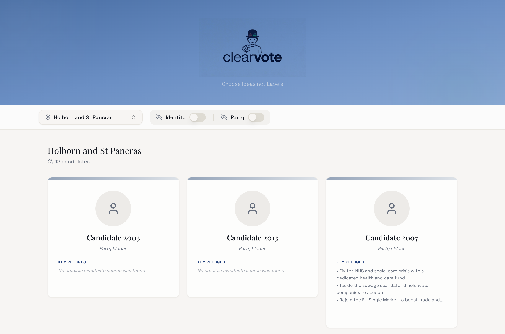
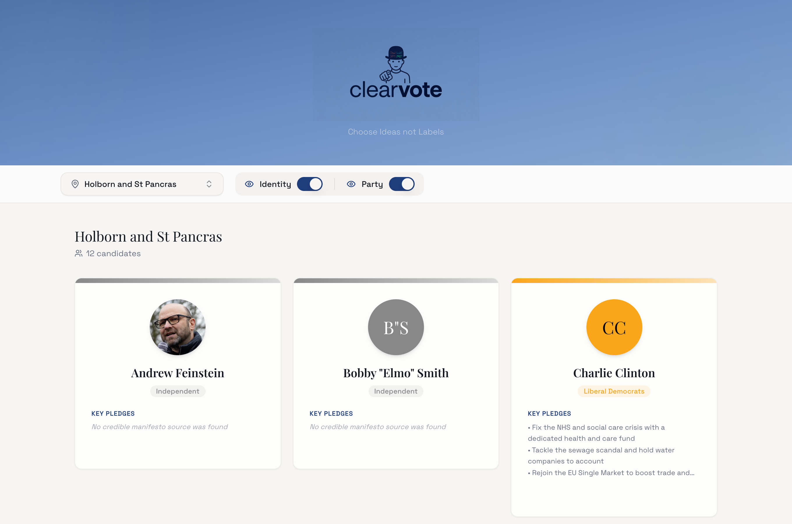

# ClearVote

**Compare UK General Election candidates on their pledges — with names, faces and party labels hidden until you choose to reveal them.**

**[Live demo →](https://mustafa-os.github.io/ClearVote/#/)**



## What it does

ClearVote is a blind tasting for UK politics. Pick any of the 650 constituencies from the July 2024 General Election and read what each candidate actually stood for, with the usual shortcuts stripped away:

- **Identity hidden** — candidates appear as "Candidate 2003" with a neutral avatar
- **Party hidden** — no party names, colours or branding; every card looks identical
- **Judge the pledges first**, then flip the Identity and Party toggles to see who you agreed with
- **Remove candidates** you have ruled out, and reset to bring them all back
- **Open any card** for a detail view with the full pledge list and a link to the candidate's [WhoCanIVoteFor](https://whocanivotefor.co.uk) profile

Flip both toggles and the same cards reveal photos, names and colour-coded party badges:



## How it works

A single-page React app with no backend — everything runs in the browser:

- **Live election data** is fetched from the [Democracy Club](https://candidates.democracyclub.org.uk) candidates API (every ballot for `parl.2024-07-04`). The 13 paginated requests are batched three at a time with 500 ms pauses to stay inside the API's rate limits
- **TanStack Query** caches the full candidate set for an hour, so switching constituencies is instant after the first load
- **Candidate photos are lazy-loaded** per constituency from the person endpoint (cached for 24 hours) rather than fetching thousands of images upfront
- A **mapping layer** (`src/lib/candidate-mapper.ts`) converts raw ballots into a clean domain model, attaching party colours (`party-colors.ts`) and manifesto summaries
- **Key pledges** are short summaries of the 13 largest parties' published 2024 manifestos (`src/lib/party-manifestos.ts`); candidates from other parties are labelled as having no credible manifesto source
- The domain model reserves **credibility and feasibility fields** — the UI already renders scoring panels when those are populated, the planned next step

**Stack:** React 18 + TypeScript · Vite · Tailwind CSS + shadcn/ui (Radix primitives) · TanStack Query · React Router · Framer Motion · deployed to GitHub Pages via GitHub Actions

## Getting started

```bash
npm install
npm run dev     # Vite dev server on http://localhost:8080
npm run build   # production build to dist/
npm test        # Vitest
```

No API keys required — the Democracy Club API is public.

## Project context

Built at the Claude AI hackathon, March 2026: prototyped from a Lovable template, then built out with Claude Code and hand-written TypeScript. Candidate data from [Democracy Club](https://democracyclub.org.uk).

---

Built by Mustafa Suleman — MEng Design Engineering, Imperial College London · [LinkedIn](https://www.linkedin.com/in/mustafaosuleman/)
